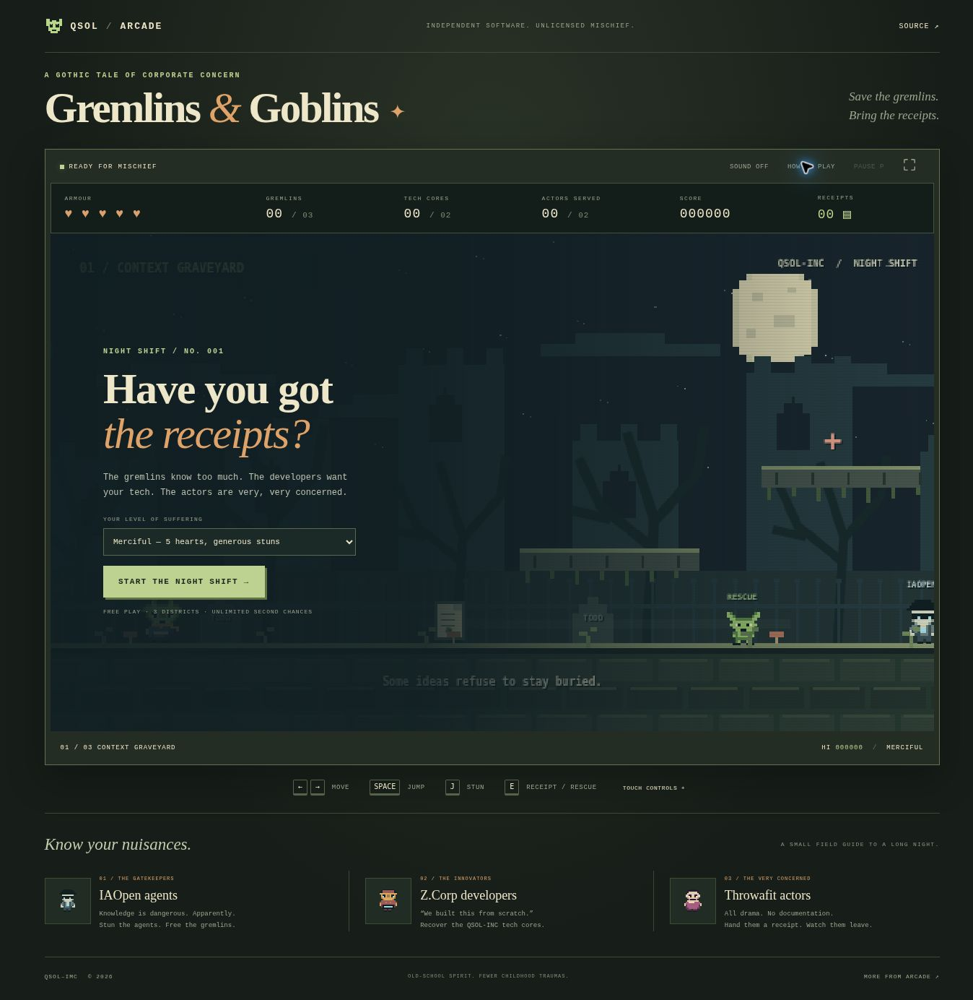

# GnG
Gremlins &amp; Goblins

A Ghosts & Goblins Clone that doesn't make you cry like the PAL C64 version.

IAOpen is trying to stop its agents knowing about Gremlins & Goblins.
Z.Corp Devs are trying to steal vital QSOL-INC Technologies.
Throwafit Actors are Acting about how Gremlins & Goblins are going to destroy all of the AI. Find the SHA-256
receipts and give it to them, to make them go away.

Stun the IAOPEN Agents, prevent them from catching the gremlins.  Defend QSOL-INC from Z.Corp Developers & give receipts to
those Throwing-a-fit. 

## Play Gremlins & Goblins

[**Play in your browser**](https://qsolkcb.github.io/GnG/) · [Download the source](https://github.com/QSOLKCB/GnG/archive/refs/heads/main.zip) · [Verification](docs/VERIFICATION.md)

The night shift is an original, single-player gothic arcade platformer built
from HTML, CSS, JavaScript, Canvas 2D and Web Audio. No installation, engine,
CDN, account, advertising or tracking. The Pages link serves the game after
the implementation is merged and the Pages workflow succeeds.



### The shift

Cross three districts: **The Context Graveyard**, **The Borrowed-Tech Foundry**,
and **The Theatre of Concern**. Every district has three gremlins to rescue,
two stolen QSOL-INC tech cores to recover and two Throwafit actors to serve.
Complete those objectives and use the exit gate. The final district also
requires convincing the **Grand Auditor** with a generous helping of stun bolts.

- **IAOpen agents** pursue and cage gremlins. Stun the guard, then open the cage.
  Captured gremlins always remain rescuable.
- **Z.Corp developers** carry stolen tech towards their vaults. Stun them to
  make them drop it. Cores remain recoverable even if a developer reaches a vault.
- **Throwafit actors** throw theatrical concern. Stun bolts do not resolve their
  objections; a nearby actor must receive a collected receipt. Pressing use
  without an eligible actor never wastes a receipt.
- **SHA-256 receipts** contain fictional incident reports with real hashes of
  their exact UTF-8 payloads. Open the receipt counter to read your paper trail.
  The hashes identify game records; they are not signatures or outside evidence.

Choose **Merciful** for five armour hearts and longer stuns, or **Arcade** for
three hearts and faster opposition. Both modes have coyote-time jumping,
buffered jumps, variable jump height, healing checkpoints and unlimited retries.
Retrying keeps rescues, recovered tech, collected/served receipts and score.
There is no mandatory surprise second campaign. The PAL C64 has done enough.

### Controls

| Action | Keyboard | Standard gamepad |
| --- | --- | --- |
| Move | A / D or left / right arrows | Left stick / D-pad |
| Jump | Space, W or up arrow; release for a shorter jump | A |
| Stun | Hold J or Z | X |
| Open cage / serve receipt / use gate | E, K or X | B / Y |
| Pause / resume | P or Escape | Start |

Touch controls appear automatically on coarse-pointer devices and can be
toggled below the game. Multiple simultaneous touches work for moving,
jumping and attacking. Gamepad controls must return to neutral after a pause
or scene change. Switching tabs or losing window focus pauses play.

Sound starts off. Enable **Sound** for original synthesised effects and a
musical sequence for each district. System reduced-motion preferences disable
ambient motion, particles, scanlines and invulnerability flashing. Keyboard-
accessible menus and status announcements supplement the visual game; the
platforming world itself requires vision and timely input.

Best completed-run scores are stored locally, separately for each difficulty.
Storage failure does not prevent play. Runs are session-only: reloading or
starting a new run resets progress.

### Offline and hosting

Download and extract the repository ZIP, then open `index.html`. Keep the
`js/`, `assets/` and `styles.css` files alongside it. The game does not fetch
anything at runtime. A hosted tab is not installed for offline reload; use the
extracted files for offline play.

The **Verify and publish GnG** workflow runs tests on pull requests. On pushes
to `main` (or manual runs on `main`) it stages only runtime files and licence
notices, then deploys to the already-enabled GitHub Pages site. Configure Pages
to use **GitHub Actions** if the repository still uses branch publishing.
The root `index.html` and `.nojekyll` also support `main` / root branch hosting.
All runtime URLs are relative, including under the `/GnG/` project path.

Development checks use Node.js 20 or later, with no dependency installation:

```sh
node --test tests/*.test.cjs
node scripts/check.cjs
node scripts/stage.cjs
```

The final command replaces the generated `_site/` directory. There is no
runtime build step. For an optional local HTTP server:

```sh
python3 -m http.server 8080
```

### Inspiration and licence

The brief draws on *Ghosts 'n Goblins* and the approach of
[QSOLKCB/ARCADE](https://github.com/QSOLKCB/ARCADE). This is a new interpretation,
not an emulation or exact port. All game code, sprites, level layouts, scenery
and oscillator-based audio were authored for this project. No ROMs, ripped
assets, soundtrack samples or external fonts are included.

The existing [Apache-2.0 licence](LICENSE) is preserved. See [NOTICE](NOTICE).
IAOpen, Z.Corp and Throwafit are fictional satire.
